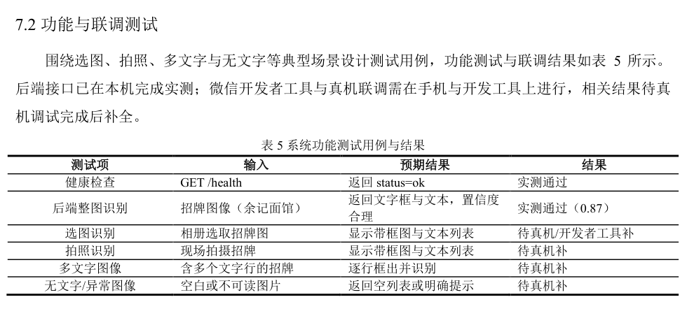
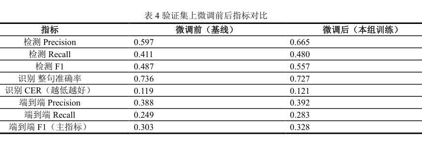

# 自然场景 OCR 视觉识别系统

本地 CPU 原型：完成「文字检测 → 单行识别」两阶段 OCR 闭环，后端用 FastAPI 提供推理服务，前端是原生微信小程序，手机拍照或从相册选图后，返回带文字框的标注图、识别文本与每条结果的置信度。

这是一个个人项目原型，不是企业级落地产品，也没有线上流量。仓库不包含模型权重与 PaddleOCR 框架源码，复现需要自行准备数据集与训练依赖。

## 演示视频

[点击观看项目演示视频](https://github.com/kk-20040526/scene-ocr/releases/tag/v1.0.0)

视频覆盖：开发者工具内选图识别、带框标注与置信度列表展示，以及手机真机通过局域网地址联调的过程。

## 运行截图



## 项目定位

项目重点是把一条完整 OCR 链路跑通并工程化：

- 检测阶段用 DBNet 找出图中所有文字行的四点框；
- 对倾斜/透视的文字行做透视校正后裁剪，送入识别模型；
- 识别阶段用 SVTR 结构 + CTC 解码出单行文本；
- 结果按阅读顺序排序，过滤低置信度噪声框后返回前端。

配套实现了检测、识别、端到端三层评测脚本，而不是只看单张样例的主观效果。

## 系统架构

```
手机拍照 / 相册选图
       │
       ▼
┌─────────────────────┐
│   微信小程序前端      │
│  拍照 / 选图 / 展示  │
└──────────┬──────────┘
           │ HTTP
           ▼
┌─────────────────────┐
│   FastAPI 后端服务   │
│  POST /ocr 接口      │
└──────────┬──────────┘
           │
           ▼
┌─────────────────────────────┐
│         OCR 推理引擎          │
│  DBNet 检测 → 透视校正裁剪   │
│  → SVTR + CTC 单行识别       │
│  → 阅读顺序排序与置信度过滤  │
└─────────────────────────────┘
```

## 技术栈

| 类别 | 技术 |
|------|------|
| 深度学习框架 | PaddlePaddle 2.6.2（CPU 版） |
| 检测模型 | DBNet（PPLCNetV3 骨干 + RSEFPN + DBHead） |
| 识别模型 | PP-OCRv3 结构（MobileNetV1Enhance + SVTR + CTC） |
| 后端 | FastAPI + Uvicorn |
| 前端 | 微信小程序（原生） |
| 评测 | 检测 F1、识别 CER / 整句准确率、端到端 F1 |

## 数据集

基于街景招牌图像自建检测与识别数据集：

- 检测：训练 7200 张，验证 800 张；
- 识别：从图中裁出文本行，训练 39491 行，验证 4283 行；
- 原始街景招牌图像共 8000 张。

## 模型效果

在 800 张验证集上评估（微调前基线 vs 本组训练后）：

| 指标 | 微调前（基线） | 微调后（本组训练） |
|------|--------------|------------------|
| 检测 Precision | 0.597 | 0.665 |
| 检测 Recall | 0.411 | 0.480 |
| 检测 F1 | 0.487 | 0.557 |
| 识别整句准确率 | 0.736 | 0.727 |
| 识别 CER（越低越好） | 0.119 | 0.121 |
| 端到端 Precision | 0.388 | 0.392 |
| 端到端 Recall | 0.249 | 0.283 |
| 端到端 F1（主指标） | 0.303 | 0.328 |



评测口径：检测框 IoU ≥ 0.5 记为匹配；文本经 NFC 规范化后完全一致才算识别正确；图内一对一最大权匹配（匈牙利算法），避免重复计数。

## 目录结构

```
scene-ocr/
├── deploy/
│   ├── ocr_engine.py           # 检测 + 校正 + 识别推理引擎
│   ├── server.py               # FastAPI 推理后端（/health、/ocr）
│   ├── evaluate.py              # 三层评测脚本
│   ├── generate_predictions.py # 生成 predictions.jsonl
│   └── generate_sample_figures.py # 样例可视化
├── miniprogram/
│   ├── pages/index/             # 小程序主页（拍照 / 选图 / 展示）
│   ├── app.js / app.json / app.wxss
│   └── project.config.json
├── configs/
│   ├── det_train.yml            # 检测训练配置
│   └── rec_train.yml             # 识别训练配置
├── images/                      # 截图与指标图
├── requirements.txt
└── README.md
```

## 快速开始

### 环境要求

- Windows 10/11，Python 3.11
- PaddlePaddle 2.6.2（CPU 版）
- 微信开发者工具（运行小程序时需要）

### 1. 安装依赖

```bash
pip install -r requirements.txt
```

### 2. 启动后端

```bash
uvicorn deploy.server:app --host 0.0.0.0 --port 8000
```

### 3. 测试接口

```bash
# 健康检查
curl http://localhost:8000/health

# 上传图片识别
curl -X POST -F "file=@test.jpg" http://localhost:8000/ocr
```

返回字段：`count`（文字行数）、`results`（每条含 `points`、`text`、`score`）、`annotated_image`（叠加文字框的 JPEG，base64）。

### 4. 小程序联调

1. 微信开发者工具导入 `miniprogram/` 目录；
2. 本地设置中勾选「不校验合法域名」；
3. 模拟器地址填 `http://127.0.0.1:8000`；真机联调时手机与电脑连同一局域网，地址填电脑局域网 IP；
4. 拍照或选图后即可返回识别结果。

## 关键工程细节

### 动态图加载推理

Paddle 2.6.2 CPU 版的 `paddle.jit.save` 对 PaddleOCR 自定义 backbone/neck 结构导出会缺失权重文件，因此推理直接用动态图加载训练产出的 `.pdparams`，预处理与后处理复用 PaddleOCR 官方算子，保证结果与训练配置一致。

### 中文路径兼容

OpenCV 的 `imread` / `imwrite` 不支持中文路径，统一使用 `np.fromfile + imdecode`、`imencode + tofile` 读写图像。

### 透视校正

检测得到的四点文字框通过 `getPerspectiveTransform` + `warpPerspective` 校正为水平矩形后再送识别；竖排行自动旋转 90°。

### 阅读顺序排序

结果按「从上到下、从左到右」排序，同一行内按 x 坐标排序，符合阅读习惯。

## 边界与后续方向

当前版本是本地 CPU 原型，已知短板与对应方向：

- **检测召回是主要瓶颈**：遮挡严重、艺术字、过小字号、模糊场景容易漏检；后续可补充难样本进入训练集，并在推理侧调整长边分辨率与框得分阈值做对照实验。
- **训练规模受算力限制**：训练在 CPU 上完成，单轮检测约 3.4 小时、识别约 5.3 小时，训练轮数与难样本补充都受限；接入 GPU 后可拉起训练轮数。
- **推理参数尚未系统调优**：提高推理分辨率、降低框得分阈值可能改善召回，但会增加耗时并带来更多误检，需要在验证集上做完整对照后再取舍。

## 相关资源

- [PaddleOCR 官方仓库](https://github.com/PaddlePaddle/PaddleOCR)
- [DBNet 论文](https://arxiv.org/abs/1911.08947)
- [PP-OCRv3 论文](https://arxiv.org/abs/2206.03001)
- [FastAPI 官方文档](https://fastapi.tiangolo.com/)
